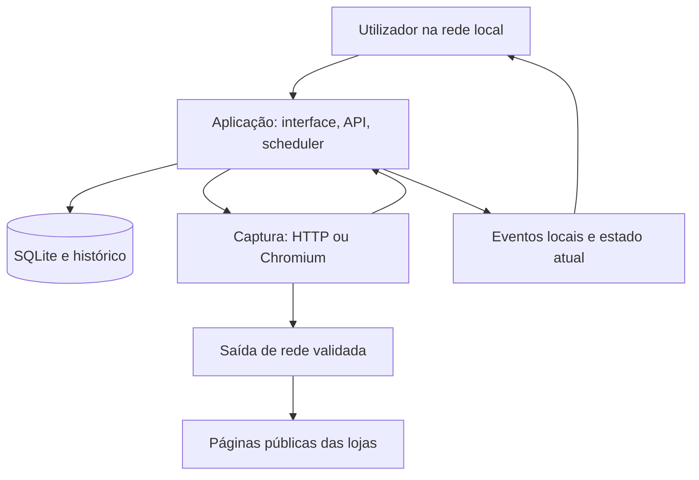

# MonitorChange — plano de execução e checklist

**Estado:** implementação inicial em curso; Docker Desktop validado em loopback, instalação LAN e piloto ainda pendentes.  
**Versão do plano:** 1.0 — 12 de novembro de 2026.  
**Âmbito:** aplicação autoalojada para acompanhar disponibilidade de produtos em várias lojas.  
**Documento de produto:** [README.md](README.md).

Este documento é o roteiro da implementação já iniciada. Inclui as decisões iniciais, os contratos que o código terá de respeitar, as tarefas por ordem de dependência e a evidência necessária para concluir cada fase. Os valores técnicos propostos são pontos de partida a medir; não representam desempenho já verificado.

## 1. Como usar e manter esta checklist

1. Ler o README e este plano antes de iniciar ou retomar trabalho.
2. Consultar o registo de execução no fim do documento e identificar a primeira tarefa incompleta cujas dependências estejam concluídas.
3. Executar por fases. Só antecipar uma tarefa se as dependências estiverem satisfeitas e isso não criar inconsistências.
4. Manter os identificadores das tarefas estáveis. Novas tarefas recebem novos identificadores; não reutilizar IDs.
5. Marcar `[x]` apenas quando o resultado existir e os critérios associados tiverem sido verificados. A existência de código, por si só, não conclui uma tarefa.
6. Registar ficheiros alterados, verificações feitas, limitações e próximo passo no registo de execução. Resultados de testes devem indicar data e contexto.
7. Se uma hipótese técnica falhar, registar a evidência, atualizar a decisão e as tarefas afetadas, e continuar o trabalho possível. Não improvisar silenciosamente um comportamento incompatível com o produto.
8. Não voltar a pedir decisões já fornecidas pelo utilizador. Os detalhes ainda desconhecidos usam os valores iniciais configuráveis deste documento.
9. Não introduzir nomes, URLs, identificadores ou capturas dos produtos/lojas usados como exemplos na conversa na documentação ou em dados distribuídos. Usar exemplos sintéticos.
10. A existência de código não implica que todos os critérios de uma tarefa estejam verificados. O estado de cada fase consta das caixas e do registo no fim do documento.

### Significado dos estados

| Representação | Significado |
| --- | --- |
| `[ ]` | Por fazer ou ainda sem evidência suficiente. |
| `[x]` | Concluído com evidência registada. |
| Nota `EM CURSO: ID` | Trabalho começado; manter a caixa vazia até concluir. |
| Nota `BLOQUEADO: ID — motivo` | Falta uma condição concreta; indicar o trabalho independente que pode continuar. |
| Nota `ADIADO: ID — decisão` | Fora da entrega atual por decisão documentada; nunca marcar como concluído. |

## 2. Decisões que orientam toda a implementação

| ID | Decisão |
| --- | --- |
| D01 | Servidor sempre ligado, com Docker Compose e armazenamento persistente. |
| D02 | Interface inicialmente acessível apenas na rede local. O monitor continua a funcionar com o navegador do utilizador fechado. |
| D03 | Alertas da primeira versão ficam na interface. Email, Discord, Telegram e outros canais são uma entrega futura. |
| D04 | Um produto pode ter várias fontes/lojas. Vários produtos são suportados pelo modelo e pela interface desde o início. |
| D05 | Adicionar, editar e remover URLs acontece pela interface. Não existe uma lista fechada de lojas nem uma lista de URLs exigida antes de desenvolver. |
| D06 | País, idioma, moeda, variante e modalidades de obtenção são configuráveis. A configuração regional não garante que a loja aplique a região pretendida. |
| D07 | Marketplace fica excluído por omissão. A identificação do vendedor pertence à oferta, não ao domínio da página. |
| D08 | Stock físico, compra online e reserva/compra para levantamento são conceitos distintos. |
| D09 | Lojas físicas têm de corresponder às lojas/zona selecionadas antes de satisfazerem os critérios de alerta. |
| D10 | O produto é um monitor. Não executa compras, reservas, subscrições de avisos da loja nem adições ao carrinho. |
| D11 | Não há IA, SaaS de monitorização, geocodificação cloud, proxies comerciais ou conta externa obrigatórios. |
| D12 | A cobertura usa um motor genérico, configuração assistida e adaptadores opcionais. Casos não suportados devem ser explicados. |
| D13 | Erro, bloqueio, dados em falta e informação contraditória nunca se convertem automaticamente em esgotado ou disponível. |
| D14 | Os exemplos reais da conversa ajudam a formular requisitos, mas não entram nos documentos, fixtures, código ou configuração inicial. |
| D15 | A primeira entrega é uma aplicação utilizável com fiabilidade, histórico, backup e controlo de acesso; notificações externas não condicionam essa entrega. |

## 3. Resultado esperado e limites da primeira entrega

A primeira versão estará pronta quando for possível instalar a aplicação no servidor, abrir a interface na LAN, criar produtos e fontes, confirmar critérios de monitorização, obter observações periódicas e consultar eventos fiáveis. Uma fonte que não possa ser interpretada deverá mostrar o motivo e permitir rever a configuração.

O número inicial de artigos não limita o desenho: não pode existir um produto único fixo no código, nem uma loja codificada como requisito do motor. A prova técnica pode usar páginas sintéticas representativas; URLs reais introduzidos pelo utilizador servem para avaliação manual de compatibilidade, sem se tornarem dependências dos testes ou da aplicação.

### Incluído na primeira entrega

- Gestão de produtos, fontes, critérios e perfis regionais.
- Consulta HTTP e navegador Chromium para páginas dinâmicas.
- Extração de várias ofertas da mesma página.
- Configuração assistida e seleção visual de elementos, com alternativa textual acessível.
- Filtros de vendedor, variante, condição, preço e modalidade/localização.
- Agendamento persistente, verificação manual, tratamento de erros e histórico.
- Alertas locais persistentes, leitura/arquivo e contagem de não lidos.
- Autenticação local, importação/exportação, backup/restauro e diagnóstico.
- Docker com dependências locais e rede de captura restringida.

### Entregas posteriores

- Email, Discord, Telegram e outros canais de aviso opcionais.
- Mais adaptadores de plataformas/lojas e melhorias guiadas por falhas reais.
- Sessões autenticadas, se forem pedidas; exigem desenho específico para segredos e expiração.
- Acesso remoto, vários utilizadores, vários servidores ou base de dados externa, se existir necessidade.
- IA opcional para sugerir regras, sem autoridade para declarar stock por si só.

## 4. Arquitetura e escolhas técnicas

### 4.1 Stack de referência

Estas escolhas evitam reconstruir bibliotecas de navegador, parsing ou persistência. As versões exatas serão fixadas na fase P01, após confirmar compatibilidade e suporte, e ficarão no lockfile e nas imagens de distribuição.

| Área | Escolha inicial | Motivo e condição |
| --- | --- | --- |
| Linguagem | TypeScript no servidor e interface; Node.js LTS suportado | Partilhar contratos de dados e reduzir tecnologias a manter. |
| Interface | React + Vite, recursos servidos localmente | Interface interativa e build estático; sem dependência de CDN em execução. |
| API | Fastify e esquemas JSON Schema definidos pela aplicação | Contratos explícitos de entrada/saída. Regras do utilizador são dados e não esquemas executáveis. |
| Persistência | SQLite através de better-sqlite3, migrações SQL versionadas | Instalação simples e adequada à primeira escala. Transações curtas; tarefas pesadas fora do event loop. |
| Agendamento | Fila persistente na mesma base de dados, gerida pela aplicação | Não requer Redis nem serviço de filas externo. |
| HTML | Parser DOM sem executar scripts, biblioteca selecionada em P01 | Extrair estrutura e texto com limites de tamanho e complexidade. |
| Navegador | Playwright + Chromium, versões compatíveis fixadas | Conteúdo dinâmico, elementos visíveis e configuração visual. |
| Verificação | Vitest para domínio/API; Playwright para fluxos da interface e captura | Casos de negócio determinísticos com páginas sintéticas. |
| Distribuição | Docker Compose, imagens versionadas | Arranque, atualização e persistência reproduzíveis. |

Fastify documenta validação baseada em JSON Schema; o driver SQLite escolhido expõe transações e acesso local. Estas capacidades são a base técnica, não uma garantia de desempenho da aplicação. [Fastify](https://fastify.dev/docs/latest/Reference/Validation-and-Serialization/) · [better-sqlite3](https://github.com/WiseLibs/better-sqlite3)

### 4.2 Serviços e responsabilidades



- **app:** serve interface/API, guarda configurações, agenda jobs, analisa resultados, aplica critérios e cria eventos. É o único proprietário das escritas SQLite. Não executar várias réplicas deste serviço sobre a mesma base.
- **capture:** recebe trabalhos autenticados da aplicação e devolve capturas limitadas. Usa HTTP ou Chromium conforme a estratégia. Não monta a base de dados, backups ou ficheiros do anfitrião. O modo HTTP funciona mesmo se o navegador estiver temporariamente indisponível.
- **egress:** componente local de saída que valida destinos e ligações públicas para as capturas. A implementação concreta e a escolha de biblioteca/proxy mantido são decididas na prova técnica de rede; a política de destino descrita em P03 é obrigatória.
- **dados:** volume local para SQLite; diretórios separados para evidência temporária e backups. SQLite não é um quarto serviço de rede.
- **integrações futuras:** consumidores dos eventos guardados, com políticas de destino próprias; não misturar a permissão de um webhook local configurado pelo administrador com a permissão de uma página monitorizada aceder à LAN.

O navegador deve correr sem root e com sandbox compatível. A documentação do Playwright descreve cuidados próprios para crawling e não recomenda assumir que a imagem padrão oferece isolamento suficiente para páginas não confiáveis. A distribuição terá de validar utilizador, sandbox, seccomp e rede no anfitrião suportado. [Playwright em Docker](https://playwright.dev/docs/docker)

### 4.3 Persistência e escala inicial

- SQLite fica num disco local do servidor, não num volume NFS/SMB. WAL permite leitores concorrentes, mas mantém apenas um escritor e não deve ser usado sobre um filesystem de rede. [SQLite WAL](https://www.sqlite.org/wal.html)
- O agendador persiste jobs, leases e estado antes de enviar trabalho ao capture. Resultados não podem escrever diretamente na base de dados.
- A API mantém transações pequenas. Parsing grande, compressão e cálculos pesados usam tarefas separadas ou worker threads.
- O piloto de capacidade terá como alvo inicial 50 fontes a cada 10 minutos: 40 HTTP e 10 JavaScript, distribuídas por pelo menos 10 domínios controlados. É um objetivo a medir, não um limite funcional nem um desempenho prometido. Registar também a capacidade com proporções diferentes de páginas dinâmicas quando houver medições.
- Quando a fila ultrapassar a capacidade, mostrar atraso real e aplicar limites; nunca fingir que a última observação é recente.
- Migrar para uma fila/base externa só se as medições demonstrarem necessidade. Esse trabalho não pertence ao MVP.

### 4.4 Estrutura futura do repositório

Os caminhos abaixo são previstos; criar apenas quando começar a implementação.

```text
apps/web/                  interface e componentes
apps/api/                  API, scheduler, serviços de aplicação
apps/capture/              HTTP, Chromium e protocolo de captura
packages/contracts/        esquemas de API e contratos internos
packages/domain/           ofertas, evidência, critérios e transições
packages/extractors/        motor genérico e interface de adaptadores
packages/storage/          acesso a SQLite e migrações
infra/                     Docker, rede e configurações de distribuição
tests/fixtures/            páginas sintéticas e respostas controladas
tests/integration/         persistência, jobs, rede e eventos
tests/e2e/                 fluxos da interface e navegador
docs/                      operação, decisões e relatórios futuros
README.md
PLANO_IMPLEMENTACAO.md
AGENTS.md
```

## 5. Modelo de domínio e contratos de dados

### 5.1 Hierarquia que não pode ser perdida

`Produto → Fonte → Verificação → Ofertas observadas → Modalidades/lojas → Evidências`

Um URL pode mostrar vários vendedores, preços e modalidades. Guardar um único vendedor ou preço por verificação destruiria informação e permitiria combinar indevidamente o preço da loja principal com o stock de um terceiro.

| Entidade | Campos/relações mínimos |
| --- | --- |
| Produto | ID, nome, marca/modelo opcionais, GTIN/EAN opcional, atributos pretendidos, critérios base, datas. |
| Fonte | ID, produto, URL original, URL de consulta, nome da loja, estado ativo/pausado, perfil regional, intervalo, estratégia, revisão de configuração. |
| Perfil regional | ID, país, locale, moeda esperada, fuso de apresentação, código postal/cidade opcionais, lojas aceites, coordenadas opcionais e raio. |
| Política de critérios | Escopo de vendedor, vendedores aceites/recusados, condições/variantes aceites, modalidades, limite/base de preço, moeda, preferência de alerta. |
| Regra | Fonte e versão, âmbito do produto/oferta, candidatos de seletor, condições positivas/negativas, passos permitidos, perfil e evidência de confirmação. |
| Job | ID, fonte, revisão capturada, motivo, prioridade, due_at, tentativa, lease_token, lease_expires_at, estado. |
| Verificação | ID, job, fonte, revisão, início/fim UTC, método, URL final, resultado de acesso, código HTTP, duração, cobertura da extração. |
| Oferta observada | ID, verificação, chave estável quando possível, produto/variante, vendedor/identidade, condição, preço e restrições observadas. |
| Modalidade observada | Oferta, tipo, store_id opcional, região, stock, capacidade de compra/reserva, evidência, resultado dos critérios. |
| Evidência | Verificação/oferta/modalidade, origem DOM/JSON-LD/adaptador, seletor/ponteiro, texto limitado, momento, frescura, qualidade. |
| Estado acompanhado | Chave oferta/modalidade/loja/variante + revisão dos critérios, última leitura válida, baseline, episódio, estado atual e candidato. |
| Evento | ID, fonte/produto, chave acompanhada, episódio, tipo, antes/depois, motivo, timestamps, estado de leitura/arquivo. |
| Configuração local | Limites, retenção, preferências, versão do schema, autenticação; segredos ficam fora de exportações comuns. |

### 5.2 Identidade, cardinalidade e valores desconhecidos

- IDs internos são estáveis e independentes do nome apresentado. A mesma loja física não é identificada apenas por uma etiqueta traduzida.
- Identificar oferta por ID da loja quando disponível; alternativa composta por fonte, vendedor, variante e condição. Modalidade e loja física completam a chave de acompanhamento.
- Uma alteração apenas na ordem das ofertas não cria um evento. Uma mudança de vendedor não herda o stock/episódio do vendedor anterior.
- A mesma URL pode existir em contextos de região/variante diferentes. Avisar sobre duplicados equivalentes, sem impedir contextos legítimos.
- Preservar parâmetros de query funcionais e fragmentos usados por aplicações. Remover tracking só por regra conhecida e confirmada; nunca apagar indiscriminadamente a query string.
- `unknown`/`null` são diferentes de `false`, zero, esgotado e não aplicável. Quantidade ausente não é quantidade zero.
- Preços usam unidades inteiras da moeda, código ISO e número de casas adequado. Não usar float para comparar dinheiro nem converter moedas implicitamente.
- Guardar preço do artigo, portes, total conhecido, entrada/prestações, preço para membros e benefícios em cartão em campos diferentes.
- Datas persistidas em UTC; a interface aplica o fuso escolhido. Idioma e fuso não alteram a localização IP do servidor.
- JSON-LD `Offer` pode fornecer vendedor, disponibilidade e preço; esses dados devem ser associados à oferta correta e confrontados com a página, não aceites como verdade isolada. [Schema.org Offer](https://schema.org/Offer)

### 5.3 Estados independentes

| Dimensão | Valores de referência | Regra |
| --- | --- | --- |
| Execução | agendada, em curso, concluída, cancelada | Não descreve stock. |
| Acesso | ok, timeout, erro HTTP, bloqueio, login necessário, limite excedido, erro de captura | Uma falha não altera o último stock válido. |
| Stock por oferta/modalidade | in_stock, out_of_stock, preorder, backorder, unknown | Pré-venda e encomenda pendente não são reposição normal. |
| Ação indicada | online_order, pickup_order, pickup_reservation, store_only, unknown | Representa o que a página permite inferir; nenhuma ação de compra é executada. |
| Elegibilidade | eligible, excluded, undetermined | Resultado dos filtros do utilizador. |
| Qualidade da evidência | forte, parcial, insuficiente | Categoria explicável; não é uma probabilidade inventada. |
| Frescura | recente, desatualizada | Pode coexistir com o último stock conhecido e erro atual. |

A interface traduz estes estados em mensagens como “Disponível para entrega segundo os teus critérios”, “Stock físico indicado, reserva não confirmada”, “Oferta excluída: vendedor externo” ou “Última leitura válida desatualizada”. Não guardar essas frases como único estado de negócio.

### 5.4 Contrato de captura e revisão

- Pedido ao capture: job ID, token de lease, URL validada, estratégia, timeout, limites, locale, região pretendida, passos permitidos e versão da configuração.
- Resposta: método, URL final, status HTTP, resultado categorizado, timestamps, conteúdo/evidência limitada, metadados e versão do extrator.
- O capture não recebe credenciais da interface nem tokens de administração. Tokens internos não são enviados aos sites.
- Uma resposta relativa a uma revisão antiga de URL/regras/perfil é registada como obsoleta e não altera o estado ativo nem cria alertas.
- Separar resultado parcial de captura completa. Uma oferta ausente numa captura parcial não implica stock esgotado.

## 6. Regras de análise, elegibilidade e alertas

### 6.1 Ordem do processamento

1. Validar destino, limites e contexto.
2. Obter a página, com HTTP ou navegador conforme estratégia.
3. Confirmar que a página corresponde ao produto/variante e à região esperados, quando existir evidência.
4. Separar blocos de oferta, vendedores, modalidades e locais.
5. Extrair sinais estruturados e visíveis, preservando o âmbito de cada sinal.
6. Classificar stock, ação indicada e qualidade por oferta/modalidade.
7. Aplicar filtros de vendedor, variante, condição, região/local, modalidade e preço.
8. Comparar com o estado anterior compatível e gerir baseline/episódio.
9. Persistir verificação, estado e evento na mesma transação quando a transição for válida.
10. Atualizar a interface sem duplicar eventos nem reclassificar uma falha como esgotado.

### 6.2 Evidência de disponibilidade

- Um botão de compra tem de pertencer à oferta correta, estar visível/ativo quando observado no navegador e não ter restrições contraditórias conhecidas.
- Texto promocional genérico, publicidade, recomendações e avaliações não são evidência de stock do produto principal.
- Um botão de aviso de reposição é uma pista contextual. Isoladamente, não prova esgotado de todas as variantes/modalidades; pode coexistir com outra oferta disponível.
- `InStock` em JSON-LD não confirma vendedor direto, entrega na região nem possibilidade de compra da variante escolhida.
- Metadados positivos e indicação visível negativa relativos à mesma oferta/contexto originam `unknown` e diagnóstico de conflito; não usar votação por maioria.
- Se o HTML contiver dados de desktop/mobile ou elementos escondidos, preferir o contexto visível da captura renderizada. Duplicados semânticos são consolidados.
- Seletores que desaparecem, encontram várias ofertas inesperadas ou mudam para outro produto exigem revisão. Ausência de texto “esgotado” não prova disponibilidade.
- A aplicação pode observar sinais de compra; não confirma a conclusão de checkout, transporte final nem reserva efetiva.

### 6.3 Filtros e valores por omissão

| Critério | Padrão inicial | Quando falta informação |
| --- | --- | --- |
| Vendedor | Apenas retalhista direto; marketplace excluído | Identidade incerta resulta em `undetermined`; pedir mapeamento confirmado na configuração. |
| Condição | Novo | Condição ambígua é apresentada; não promover usado/recondicionado silenciosamente. |
| Variante | Variante configurada; se única, confirmar a sugerida | Não misturar modelos nem assumir que outra cor/capacidade corresponde. |
| Modalidade | Compra online com entrega | Stock em loja fica informativo até o utilizador ativar modalidade e locais. |
| Levantamento | Apenas locais aceites e compra/reserva indicada | Local desconhecido ou mera consulta de stock não satisfaz o filtro. |
| Preço máximo | Desativado até definido | Se ativado e o preço relevante for desconhecido, `undetermined`. |
| Base do limite | Preço total do artigo; opção artigo + portes | Portes desconhecidos não podem satisfazer um limite configurado sobre total entregue. |
| Moeda | Moeda do perfil | Moeda diferente não é convertida; pedir critério explícito. |
| Pré-venda/backorder | Excluídos dos alertas normais | Mostrar separadamente se observados. |
| Stock físico sem reserva | Sem alerta por omissão | Pode ser ativado como aviso informativo, identificado como tal. |

O perfil do produto fornece defaults; cada fonte pode ter overrides. A interface mostra o valor efetivo e a origem. Editar uma política cria nova revisão e reavalia a baseline; não gera um falso evento de reposição por mudança de filtros.

### 6.4 Localização, proximidade e personalização

- Configuração global opcional, herdada por produto e sobreposta na fonte: país, idioma, moeda e preferências de localização.
- A região sugerida pelo URL é uma sugestão; mostrar contexto pretendido e, quando detetável, contexto observado.
- Não assumir que `Accept-Language`, locale do navegador ou código postal alteram localização IP, regras comerciais ou inventário.
- Guardar uma lista explícita de lojas preferidas é o método inicial mais previsível. Permitir escolher lojas descobertas pela página ou introduzir identificador/nome manualmente com confirmação.
- Raio geográfico só é aplicado quando existem coordenadas válidas para o ponto de referência e para a loja. Distância é em linha reta, calculada localmente e apresentada como aproximação, não como percurso de condução.
- Código postal/cidade sem coordenadas não permite inventar distância. Usar seleção manual, dados locais licenciados ou coordenadas fornecidas; nenhum serviço externo é obrigatório.
- Uma loja selecionada automaticamente pelo website, por cookies ou geolocalização não se torna automaticamente uma loja aceite pelo utilizador.
- Interações para escolher região, variante ou loja podem ser guardadas como passos limitados. Não guardar sessões partilhadas entre fontes com contextos diferentes.

### 6.5 Eventos, baseline e deduplicação

1. A primeira observação válida na ativação/revisão de uma fonte cria baseline para as ofertas então observadas. Não se chama reposição a uma disponibilidade já existente quando a fonte é criada. Uma nova chave de oferta descoberta em verificações posteriores pode gerar `eligible_offer_found` após confirmação; não inventar um estado anterior esgotado dessa oferta.
2. Pode existir a opção “avisar também se já estiver disponível”, desligada por omissão; esse evento tem tipo `initial_available`.
3. Uma oferta passa a candidato quando existe evidência forte e cumpre os critérios. Por omissão, confirmar numa segunda leitura válida pelo menos 60 segundos depois, respeitando limites por domínio. O candidato expira após `max(3 × intervalo, 30 minutos)` e é invalidado por erro, conflito, evidência parcial ou mudança de contexto entre leituras. Invalidar candidato não elimina o último estado confirmado nem rearma episódios; uma leitura positiva posterior inicia nova confirmação.
4. O modo rápido de uma leitura pode ser escolhido explicitamente por fonte; a interface explica o compromisso entre rapidez e falsos positivos. Evidência fraca ou em conflito nunca é suficiente.
5. Para a mesma chave de acompanhamento, `out_of_stock → in_stock` elegível cria `restocked`. Uma primeira oferta que surge depois de cobertura incompleta cria `eligible_offer_found`, sem afirmar reposição de um stock que nunca foi observado.
6. Uma oferta cujo stock e ação já permitiam a compra, e que apenas passou a cumprir um limite de preço, cria `price_eligible`. Baixar o preço mantendo stock esgotado não gera aviso de compra. Se stock e preço mudarem simultaneamente para satisfazer critérios, criar um único evento principal `restocked` com motivo adicional de preço; para oferta recém-descoberta, prevalece `eligible_offer_found`.
7. Cada transição de compra elegível tem chave única composta pelo acompanhamento, revisão de critérios e episódio, independentemente do tipo principal escolhido. Eventos de diagnóstico usam o seu próprio episódio/namespace. Reprocessar o mesmo job ou detetar dois motivos na mesma transição não duplica o evento.
8. Falhas de acesso, capturas parciais, seletores vazios e estado desconhecido preservam o último estado válido e não rearmam alertas. A interface mostra a degradação/frescura em separado.
9. Rearmar após saída válida da condição de elegibilidade, confirmada com a mesma política de estabilidade. Não rearmar porque o utilizador leu ou arquivou o evento.
10. Pausa/retoma não gera nova reposição por si só. Mudança de URL, perfil, regra ou variante invalida candidatos antigos e cria nova baseline.
11. Alertas de falha são eventos de diagnóstico distintos, por episódio de falha; podem ser arquivados sem afetar alertas de stock.
12. No resumo de um produto, só mostrar elegibilidade positiva se existir uma oferta recente que cumpre critérios. Se todas as leituras estiverem incompletas, excluídas ou desatualizadas, explicar isso em vez de concluir esgotado global.

## 7. Interface a implementar

| Ecrã | Conteúdo e ações obrigatórios |
| --- | --- |
| Primeiro acesso | Criar credencial local através de bootstrap protegido; configurar idioma/fuso e região opcional; sem conta externa. |
| Painel de produtos | Pesquisa, filtros de estado, nome, quantidade de fontes, melhor oferta elegível recente, últimas leituras e alertas. |
| Produto | Fontes agrupadas, variantes pretendidas, critérios herdados, comparação de ofertas e ações de adicionar fonte/editar/arquivar. |
| Assistente de fonte | URL → análise → produto/variante → vendedor/modalidade/local/preço → regra/evidência → baseline → ativar. |
| Detalhe de fonte | Método, próxima execução, atraso, estado, ofertas, vendedor, modalidade, loja, preço, evidência e histórico. |
| Seletor visual | Screenshot com regiões selecionáveis, descrição textual equivalente, papel/texto do elemento, preview da regra e teste de correspondência. |
| Eventos | Não lidos/lidos/arquivados, causa, oferta, antes/depois, hora, ligação à fonte e ação de abrir a loja manualmente. |
| Configurações | Perfis regionais, limites, retenção, autenticação, exportação/importação e diagnóstico. |

### Regras de interação

- Estados vazios ensinam a adicionar o primeiro produto/fonte e não exigem conhecimento de CSS.
- O nome do produto pode ser sugerido pela página e editado. Uma URL isolada permite criar o produto no mesmo fluxo.
- Mostrar diferenças entre “última tentativa”, “última leitura válida” e “próxima verificação”.
- Fonte HTTP insuficiente oferece ou usa fallback configurado para Chromium; se Chromium estiver indisponível, mostrar motivo e manter o diagnóstico.
- As opções avançadas ficam acessíveis sem ocupar o fluxo principal. Não mostrar IDs internos, SQL ou nomes de classes como instruções ao utilizador.
- Não carregar HTML de terceiros na origem da aplicação. O seletor mostra imagem e metadados inertes obtidos pelo capture.
- Screenshot e mapa de elementos pertencem ao mesmo `capture_id`/revisão imutável. Ao selecionar um ponto, resolver no mapa capturado, gerar seletores candidatos e validar a identidade antes de guardar. Se o DOM tiver mudado, recapturar em vez de associar coordenadas antigas a outro elemento. A seleção nunca executa um clique físico no botão da loja.
- O token de sessão visual é temporário e vinculado à fonte/revisão. A sessão expira, fecha contextos e permite recapturar sem perder critérios preenchidos.
- Proporcionar seleção por lista textual e teclado; estados e alertas não podem depender apenas da cor.
- A interface deixa claro que um aviso de stock físico não reserva o artigo e que é o utilizador quem abre a loja para comprar.
- O painel atualiza por polling curto enquanto aberto; fechar o navegador não interrompe jobs nem perde eventos.

## 8. API prevista

API local sob `/api/v1`, autenticada, com esquemas de entrada/saída, paginação e erros uniformes. IDs abaixo representam recursos, não caminhos no filesystem.

| Recurso | Operações previstas | Regras |
| --- | --- | --- |
| `/session` | Criar, consultar, terminar | Sessão local; cookies HttpOnly; limitação de tentativas e proteção CSRF/Origin. |
| `/products` | Listar/criar | Nome e critérios base; listas paginadas. |
| `/products/:id` | Consultar/editar/arquivar | Revisões de configuração; arquivar não apaga histórico de imediato. |
| `/products/:id/sources` | Listar/adicionar | Várias fontes por produto. |
| `/sources/:id` | Consultar/editar/remover | URL/perfil/regra alterados invalidam jobs/candidatos antigos; remoção explícita. |
| `/sources/:id/pause` e `/resume` | Ações | Operações idempotentes; retoma não altera stock por si só. |
| `/sources/:id/checks` | Listar/solicitar execução | POST devolve 202 e job ID; uma execução já pendente pode ser reutilizada. |
| `/checks/:id` | Consultar resultado | Distinguir em curso, falha e observação válida. |
| `/analysis-sessions` | Iniciar análise/configuração | TTL, limites, fonte/produto e contexto; sem SSRF bypass. |
| `/analysis-sessions/:id` | Consultar/cancelar | Imagem, ofertas e candidatos paginados/limitados. |
| `/analysis-sessions/:id/selection` | Selecionar/testar/guardar regra | Metadados validados; nenhum JavaScript arbitrário recebido. |
| `/profiles` | CRUD de perfis regionais | Mostrar dependências antes de eliminar perfil em uso. |
| `/events` | Listar/filtrar | Cursor e estado de leitura; resposta sem dados secretos. |
| `/events/:id` | Marcar lido/arquivar | Não rearmar alertas. |
| `/settings` | Consultar/editar | Campos permitidos explicitamente; segredos nunca devolvidos. |
| `/exports` e `/imports` | Exportar/validar/importar | Validação e preview antes de aplicar; não agendar automaticamente dados importados. |
| `/health/live` e `/health/ready` | Consultas de saúde | Público apenas resumo mínimo; diagnóstico detalhado autenticado. |

Formato de erro: código estável, mensagem legível, ID de pedido e detalhes seguros de validação. O controlo de revisão deve rejeitar gravações antigas com conflito, sem sobrescrever silenciosamente a configuração mais recente.

Arquivar um produto suspende as fontes filhas, cancela trabalhos pendentes/sessões visuais e impede que resultados em curso gerem eventos, preservando histórico e critérios. Desarquivar não retoma fontes silenciosamente; mostra o estado e permite retoma explícita. Remover uma fonte faz remoção lógica com o mesmo cancelamento e conserva eventos consultáveis. Eliminar definitivamente é uma ação distinta e explícita que informa o que será apagado e elimina dependências numa transação; nunca apagar histórico como efeito secundário de pausar.

## 9. Valores iniciais configuráveis

| Parâmetro | Valor inicial proposto | Observação |
| --- | --- | --- |
| Intervalo normal | 10 minutos por fonte | Permitir ajuste; evitar polling agressivo. |
| Intervalo mínimo | 60 segundos | Manual, confirmação e automático partilham o limite de domínio. |
| Variação de agenda | Até 10%, respeitando mínimo | Distribuir execuções de fontes criadas em conjunto. |
| Concorrência HTTP | 4 global | Afinar após medir consumo e fila. |
| Concorrência Chromium | 1 contexto de trabalho | Sessões visuais partilham o orçamento, sem bloquear indefinidamente o scheduler. |
| Por domínio | 1 captura concorrente e pelo menos 60 segundos entre inícios | Agrupar pelo domínio registável; considerar também pedidos de análise/manual. |
| Timeout HTTP | 20 segundos | Limite total, incluindo corpo. |
| Timeout browser | 45 segundos | Espera por elemento útil; não depender de `networkidle` infinito. |
| Redirecionamentos | Até 5 | Revalidar cada destino e preservar evidência de URL final. |
| HTML descomprimido | Até 5 MiB | Limitar também transferência e descompressão. |
| Página renderizada | Até 25 MiB e 200 pedidos de rede | Limites iniciais a medir; ao exceder, classificar como captura incompleta. |
| Lease de captura | 120 segundos | Superior ao timeout; token de geração impede escrita tardia. |
| Sessão visual | 5 minutos sem atividade; 10 minutos totais | Expirar e libertar recursos. |
| Desatualizado | Após `max(3 × intervalo, 30 minutos)` sem leitura válida | Último estado aparece com aviso, não como observação atual. |
| Histórico detalhado | 30 dias | Configurável; preservar estado/episódios atuais. |
| Eventos | 90 dias | Retenção independente da evidência pesada. |
| Capturas diagnósticas | 7 dias, com teto global de 500 MiB | Sanitizar e eliminar por antiguidade quando excedido. |
| Limite do export/import | 10 MiB e 1.000 fontes | Valores configuráveis; validar complexidade além do tamanho. |
| Retentativa transitória | 2, 5, 15, 60 minutos; depois até 6 horas | `Retry-After` mais restritivo prevalece; aplicar jitter e orçamento. |
| Falhas consecutivas | Após 3, estado degradado e evento único | Não transformar em esgotado nem apagar último sucesso. |
| CAPTCHA/login | Intervenção necessária e pausa de tentativas automáticas nessa fonte | Retomar quando utilizador rever; não insistir em ciclo. |

## 10. Checklist de implementação por fases

### P00 — consolidar contratos e preparar o trabalho

**Dependências:** autorização posterior para começar a implementação. **Saída:** decisões técnicas registadas e backlog alinhado.

- [ ] P00.01 Ler README, plano, instruções locais e estado real do diretório antes de alterar ficheiros.
- [ ] P00.02 Registar branch/estado de trabalho existente e preservar alterações do utilizador.
- [ ] P00.03 Confirmar os contratos de oferta, modalidade, elegibilidade, baseline e revisão descritos nas secções 5–6.
- [ ] P00.04 Registar a stack e versões suportadas escolhidas, incluindo arquitetura do servidor efetivamente disponível quando for conhecida.
- [ ] P00.05 Preparar uma matriz de capacidades e exemplos sintéticos cobrindo a secção 11; não exigir URLs reais ao utilizador como condição de início.
- [ ] P00.06 Fixar o vocabulário de estados, reason codes e eventos com nomes legíveis em português.
- [ ] P00.07 Registar valores iniciais de limites e métricas que serão medidas no piloto.

**Conclusão:** contratos sem decisões contraditórias; nenhuma referência a lojas/produtos da conversa nos dados a distribuir.

### P01 — estrutura, dependências e ambiente de desenvolvimento

**Dependências:** P00. **Saída:** estrutura mínima executável e reproduzível.

- [ ] P01.01 Criar workspaces, TypeScript, scripts e estrutura de pastas da secção 4.4.
- [ ] P01.02 Fixar Node, gestor de pacotes e dependências compatíveis num lockfile; verificar suporte do módulo SQLite na imagem alvo.
- [x] P01.03 Criar pacotes de contratos/domínio sem dependência da interface nem de frameworks de captura.
- [ ] P01.04 Configurar lint, typecheck e build; erros devem produzir saída clara e código de falha.
- [ ] P01.05 Criar aplicação web inicial e API com healthcheck mínimo.
- [ ] P01.06 Criar configuração por ambiente com validação de tipos, valores por omissão e mensagens para campos inválidos.
- [ ] P01.07 Definir logging estruturado com redaction de segredos e conteúdo sensível de URLs.
- [ ] P01.08 Preparar servidor de fixtures sintéticas exclusivo de testes; não ativar permissão de acesso à LAN em produção por causa desses testes.
- [ ] P01.09 Registar licenças e proveniência das bibliotecas usadas; qualquer reutilização de código externo deve preservar os avisos aplicáveis.

**Conclusão:** instalação de dependências, build e execução mínima reproduzidos sem tocar em outros projetos do workspace.

### P02 — modelo persistente, migrações e configurações

**Dependências:** P01. **Saída:** dados versionados e contratos persistentes.

- [ ] P02.01 Criar migração inicial para produtos, fontes, perfis, regras, jobs, checks, ofertas, modalidades, evidência, estados e eventos.
- [ ] P02.02 Definir chaves estrangeiras, índices por fonte/data/próxima execução e constraints para deduplicação de jobs/eventos.
- [x] P02.03 Implementar acesso à base de dados num único proprietário; não partilhar a montagem com capture/egress.
- [ ] P02.04 Configurar WAL, busy timeout, foreign keys e transações curtas; registar versão real do SQLite incluído.
- [ ] P02.05 Implementar dinheiro, timestamps, valores desconhecidos e identidade de oferta conforme a secção 5.
- [ ] P02.06 Implementar herança de critérios/perfis e revisão efetiva por fonte.
- [ ] P02.07 Implementar arquivar/pausar sem perda silenciosa de histórico e eliminar explicitamente com dependências controladas.
- [ ] P02.08 Criar runner de migrações com bloqueio de arranque em falha e deteção de schema mais recente que a aplicação.
- [ ] P02.09 Verificar migração numa base vazia e numa base anterior sintética, rollback operacional por restauro e transações interrompidas.

**Conclusão:** várias ofertas por página e várias modalidades por oferta sobrevivem a gravar/ler sem associação incorreta.

### P03 — captura HTTP e política de acesso à rede

**Dependências:** P01–P02. **Saída:** leitura HTTP limitada e isolamento verificável.

- [ ] P03.01 Implementar validação de URL HTTP/HTTPS, hostname, porta permitida e rejeição de credenciais embutidas/esquemas não web.
- [ ] P03.02 Definir política de portas pública inicial 80/443; outras portas só por configuração administrativa explícita e sujeitas à mesma proteção de endereços.
- [ ] P03.03 Resolver DNS, normalizar IPv4/IPv6 e bloquear loopback, privados, link-local, reservados e metadados de infraestrutura.
- [ ] P03.04 Validar o IP efetivamente usado na ligação, impedir re-resolução insegura e tratar DNS rebinding, respostas mistas públicas/privadas e redirecionamentos.
- [ ] P03.05 Escolher/implementar o componente de saída validada, com TLS verificado e hostname original preservado; não desativar validação de certificados.
- [ ] P03.06 Garantir que o capture só alcança destinos web através dessa política e não acede a API administrativa, volumes, sockets Docker ou serviços da LAN.
- [ ] P03.07 Aplicar limites de tempo, bytes descomprimidos, pedidos, redirecionamentos e tipos de conteúdo; impedir downloads automáticos.
- [ ] P03.08 Implementar headers de locale configuráveis e cache condicional com contexto de região/regra/versionamento.
- [ ] P03.09 Tratar 304 apenas quando houver uma representação válida para o mesmo contexto; não inventar uma nova observação a partir de cache incompatível.
- [ ] P03.10 Classificar 404/410, 429, 5xx, timeouts, corpo vazio, CAPTCHA, login e limite excedido sem declarar stock.
- [ ] P03.11 Guardar URL original/final e evidência mínima; mascarar tokens de query em logs.
- [ ] P03.12 Executar casos de rede controlados: URL direta interna, IPv6, redirect para LAN, DNS mutável, payload grande e compressão excessiva.
- [ ] P03.13 Demonstrar enforcement de saída no isolamento de rede: negar saída direta/UDP/QUIC e rotas alternativas; CONNECT respeita portas/IP final. Remover a configuração de proxy do browser deve fazer a captura falhar fechada, sem permitir Internet, LAN ou controlos locais do capture.

**Conclusão:** destinos proibidos não são alcançados. A inspeção do hostname sozinha não conta como prova de proteção.

### P04 — navegador e seleção visual segura

**Dependências:** P03. **Saída:** captura dinâmica e seleção de elementos isolada.

- [x] P04.01 Preparar imagem capture com Chromium/Playwright compatíveis, utilizador sem root e sandbox validada no host alvo.
- [ ] P04.02 Criar contextos descartáveis por fonte/perfil, sem partilha de cookies entre regiões/fontes e sem credenciais da interface.
- [ ] P04.03 Encaminhar navegação, subrecursos, iframes, popups e ligações relevantes pela política de rede; bloquear bypass de loopback/proxy, downloads e protocolos não autorizados.
- [ ] P04.04 Tratar service workers, WebSockets e outros caminhos que não fiquem cobertos apenas por interceptar a navegação principal; restringir/desativar quando não forem suportados com segurança.
- [ ] P04.05 Implementar espera por conteúdo/elemento com timeout; não esperar indefinidamente por silêncio de rede.
- [ ] P04.06 Criar estratégia `auto`, `http` e `browser`, com fallback por ausência de conteúdo útil; CAPTCHA/429 não deve desencadear tentativas agressivas noutro método.
- [ ] P04.07 Implementar passos limitados: escolher variante/loja/região, fechar banner ou aplicar consentimento escolhido; impedir scripts arbitrários e ações de compra/reserva/subscrição.
- [ ] P04.08 Capturar screenshot e metadados inertes de elementos, com limites de tamanho e texto.
- [ ] P04.09 Implementar seleção por mapa imutável vinculado a screenshot/capture_id e alternativa por lista; gerar seletores por papel/nome/atributos estáveis, com CSS curto como fallback. Validar identidade/recapturar se o DOM mudar, sem ativar o elemento selecionado.
- [ ] P04.10 Guardar vários candidatos de seletor com critérios de identidade; se nenhum for seguro ou houver ambiguidade, pedir revisão.
- [ ] P04.11 Expirar sessões visuais e liberar memória/processos em cancelamento, timeout, erro ou reinício.
- [ ] P04.12 Demonstrar leitura de fixture JavaScript, bloqueio de subrequest interno e impossibilidade de scripts da loja executarem na origem da interface.

**Conclusão:** uma página dinâmica pode ser configurada sem código, e o browser não ganha acesso à rede/segredos internos por estar dentro de Docker.

### P05 — extratores genéricos e evidência por oferta

**Dependências:** P03–P04. **Saída:** observações coerentes sem aplicar ainda filtros do utilizador.

- [ ] P05.01 Extrair Product/Offer de JSON-LD, incluindo arrays, `@graph`, referências internas e vários produtos; limitar tamanho/profundidade e tratar JSON malformado.
- [ ] P05.02 Extrair produto/variante, vendedor, condição, preço, modalidade, loja e sinais de stock de blocos DOM delimitados.
- [ ] P05.03 Associar evidências à oferta certa; evitar cruzar banner, recomendações, avaliações e ofertas de terceiros.
- [ ] P05.04 Normalizar formatos de preço e moeda, incluindo separadores de milhares/decimais, espaços e preço a prestações.
- [ ] P05.05 Distinguir preço normal, membro, benefícios em cartão, portes, total conhecido e prestação sem realizar simulações de crédito.
- [ ] P05.06 Criar dicionários iniciais PT/EN e condições configuráveis; não assumir cobertura linguística universal.
- [ ] P05.07 Tratar negações, duplicados desktop/mobile, textos invisíveis e botões de intenção ambígua.
- [ ] P05.08 Implementar reconciliação de evidência, conflitos e qualidade explicável conforme a secção 6.2.
- [ ] P05.09 Identificar cobertura completa/parcial e razões de `unknown` sem converter oferta desaparecida em stock zero.
- [ ] P05.10 Definir contrato de adaptador: deteção de capacidade, versão, extração normalizada, evidências e erro; impedir lógica de loja dentro do scheduler/UI.
- [ ] P05.11 Implementar um adaptador de fixture sintética para provar extensão; adaptadores reais só quando necessários e com autorização de âmbito já existente.
- [ ] P05.12 Verificar os cenários de parsing/oferta/variante/preço da matriz de aceitação.

**Conclusão:** todas as saídas incluem escopo, proveniência e motivo; nenhuma conclusão resulta apenas de encontrar uma palavra na página inteira.

### P06 — critérios de compra, região e loja

**Dependências:** P02 e P05. **Saída:** decisão de elegibilidade por oferta/modalidade.

- [ ] P06.01 Implementar marketplace excluído por omissão e vendedores permitidos/recusados por identidade confirmada.
- [ ] P06.02 Tratar vendedor desconhecido como indeterminado; permitir mapeamento manual confirmado e versionado sem presumir que o domínio vende todas as ofertas.
- [ ] P06.03 Aplicar variante, condição e restrições conhecidas; uma variante diferente nunca satisfaz silenciosamente a procurada.
- [ ] P06.04 Implementar modalidades distintas: entrega, encomenda para recolha, reserva indicada e stock físico informativo.
- [ ] P06.05 Implementar perfis regionais, diferenças entre contexto pretendido/observado e isolamento de cookies/passos.
- [ ] P06.06 Implementar lojas favoritas/lista manual e exclusão de lojas sugeridas pelo website mas não escolhidas pelo utilizador.
- [ ] P06.07 Implementar distância local quando houver coordenadas verificáveis; sem coordenadas, não atribuir proximidade.
- [ ] P06.08 Aplicar limite de preço sobre a base escolhida e moeda correta; portes/preço desconhecidos produzem indeterminado quando necessários ao filtro.
- [ ] P06.09 Produzir reason codes legíveis para exclusão e indeterminação; mostrar todos os critérios impeditivos relevantes.
- [ ] P06.10 Calcular resumo por produto com apenas ofertas elegíveis recentes e moeda comparável; apresentar ofertas excluídas separadamente para diagnóstico.

**Conclusão:** uma oferta de terceiro, numa loja distante ou com preço parcial não consegue disparar um aviso que corresponde aos critérios de compra online configurados.

### P07 — scheduler, leases, erros e recursos

**Dependências:** P02–P06. **Saída:** verificações contínuas que sobrevivem a reinícios.

- [ ] P07.01 Implementar jobs persistentes, prioridade de análise/manual e equidade para fontes automáticas.
- [ ] P07.02 Aplicar concorrência global, browser e domínio a todos os motivos de verificação.
- [ ] P07.03 Implementar claim atómico, lease com token e rejeição de resultados tardios/duplicados.
- [ ] P07.04 Impedir sobreposição da mesma fonte; vários cliques em verificar agora reutilizam job pendente quando aplicável.
- [ ] P07.05 Implementar agenda com jitter, UTC e relógio monotónico para durações; alterações de fuso não duplicam jobs.
- [ ] P07.06 Implementar backoff e `Retry-After`, circuit breaker por domínio e orçamento de tentativas.
- [ ] P07.07 Marcar CAPTCHA/login como intervenção necessária e tratar seletor inválido como revisão de regra, não falha transitória infinita.
- [ ] P07.08 Recuperar leases expirados após crash; uma execução antiga não pode sobrescrever a recuperação.
- [ ] P07.09 Ao reiniciar, não repetir cada intervalo perdido; agendar uma leitura atual com dispersão e mostrar atraso acumulado.
- [ ] P07.10 Implementar pausa, retoma, remoção e alteração de fonte durante job em curso sem produzir eventos obsoletos.
- [ ] P07.11 Medir duração, fila, falhas, capturas recentes e consumo do browser; sinalizar saturação na interface.
- [ ] P07.12 Implementar shutdown gracioso com interrupção controlada e persistência de jobs ainda não concluídos.

**Conclusão:** reiniciar serviços, receber respostas repetidas ou alterar uma fonte em curso não provoca perda silenciosa de dados nem tempestade de consultas.

### P08 — transições e caixa de eventos local

**Dependências:** P06–P07. **Saída:** eventos fiáveis e persistentes.

- [ ] P08.01 Implementar baseline por ativação/revisão, descoberta posterior de ofertas, candidato com expiração/invalidadores, confirmação e modo rápido explícito.
- [ ] P08.02 Implementar eventos distintos `restocked`, `eligible_offer_found`, `price_eligible`, `initial_available` e diagnóstico, com precedência e um único evento principal por transição elegível.
- [ ] P08.03 Persistir estado/episódio/evento numa transação com constraint de unicidade.
- [ ] P08.04 Preservar último estado válido em timeout, conflito, oferta ausente parcialmente e regra quebrada.
- [ ] P08.05 Implementar rearmamento apenas por saída válida e estável dos critérios; erros não rearmam.
- [ ] P08.06 Reiniciar baseline de forma explícita em alterações materiais de configuração sem simular reposição.
- [ ] P08.07 Implementar não lido/lido/arquivado, paginação e contagem; leitura não altera o episódio.
- [ ] P08.08 Manter eventos após fechar navegador e mostrar histórico após reconexão.
- [ ] P08.09 Reservar contrato de consumidores de eventos para notificações futuras, sem implementar canais externos nesta fase.
- [ ] P08.10 Verificar sequências completas, incluindo falha entre duas leituras positivas e recuperação após crash durante criação do evento.

**Conclusão:** existe exatamente um evento local por transição/episódio elegível e a sua causa é auditável.

### P09 — API, autenticação e interface completa

**Dependências:** contratos P02; implementação final após P04–P08. **Saída:** fluxos utilizáveis na LAN.

- [x] P09.01 Implementar bootstrap protegido por segredo temporário de instalação, sem permitir que qualquer visitante da LAN reclame o primeiro utilizador.
- [ ] P09.02 Implementar password com hash adequado, sessão, logout, expiração e limitação de tentativas.
- [ ] P09.03 Restringir CORS, validar Host/Origin e aplicar proteção CSRF a mutações; não usar GET para ações com efeitos.
- [ ] P09.04 Implementar API da secção 8 com validação, paginação, limites e conflitos de revisão.
- [ ] P09.05 Implementar painel, pesquisa e detalhe de produtos/fontes, incluindo vazio, carregamento, erro e última leitura desatualizada.
- [ ] P09.06 Implementar assistente completo URL → análise → critérios → evidência → baseline → ativação.
- [ ] P09.07 Implementar seleção visual e textual, teste de regra e mensagem de sessão expirada.
- [ ] P09.08 Implementar ofertas separadas por vendedor/modalidade/loja e motivos de exclusão/indeterminação.
- [ ] P09.09 Implementar edição de intervalos, perfis, filtros e pausa/retoma sem perder contexto.
- [ ] P09.10 Implementar caixa de eventos com ações de leitura/arquivo e ligações manuais à loja.
- [ ] P09.11 Garantir navegação por teclado, rótulos de controlos, foco, contraste e layout móvel utilizável.
- [ ] P09.12 Servir assets localmente, escapar texto de terceiros e bloquear HTML/scripts de loja na interface com CSP adequada.
- [ ] P09.13 Verificar fluxos de criação de vários produtos/fontes e conflitos de edição em duas janelas.

**Conclusão:** uma pessoa consegue configurar e acompanhar produtos sem escrever código, percebendo claramente o que foi observado e quais os critérios aplicados.

### P10 — distribuição Docker, operação e recuperação

**Dependências:** P03–P09; imagens básicas podem ser preparadas em P01. **Saída:** instalação operacional.

- [ ] P10.01 Criar Dockerfiles e Compose versionados com app/capture/egress, redes explícitas e apenas a porta da interface publicada na LAN escolhida.
- [ ] P10.02 Usar volumes locais separados, utilizadores sem root, filesystem read-only quando possível, tmpfs e limites de recursos; nunca montar Docker socket.
- [ ] P10.03 Manter capture/egress sem portas de controlo publicadas; autenticar protocolo interno e impedir acesso a controlos pela página capturada.
- [ ] P10.04 Configurar healthchecks, restart policy e disponibilidade degradada quando Chromium falha mas HTTP continua funcional.
- [ ] P10.05 Definir o perfil de transporte LAN: TLS local recomendado e documentado; se existir perfil HTTP de desenvolvimento, não o apresentar como comunicação cifrada.
- [ ] P10.06 Criar documentação `.env.example` sem segredos, arranque, alteração da credencial e acesso pelo IP/nome local.
- [ ] P10.07 Implementar exportação versionada sem passwords/cookies/tokens, com perfis, produtos, fontes, regras e critérios.
- [ ] P10.08 Implementar importação com limites, preview, validação de URL/regras, tratamento de IDs duplicados e fontes inicialmente pausadas.
- [ ] P10.09 Implementar backup consistente via API própria do SQLite/driver ou paragem controlada; não copiar apenas o ficheiro principal durante escrita WAL.
- [ ] P10.10 Documentar e executar restauro numa instância separada; verificar produtos, regras, eventos, estado e migrações.
- [ ] P10.11 Implementar retenção e teto de disco preservando estados de deduplicação ativos; sinalizar disco cheio sem perder silenciosamente eventos.
- [ ] P10.12 Definir atualização com backup prévio, migrações e procedimento de reversão por imagem + restauro compatível.
- [ ] P10.13 Documentar logs, erros comuns, falta de browser, SSRF bloqueado, região não aplicada, seletor inválido e atraso de fila.
- [ ] P10.14 Executar instalação limpa, reinício do host/serviços e atualização/restauro em ambiente representativo.

**Conclusão:** o serviço continua a monitorizar sem navegador aberto e a recuperação foi demonstrada, não apenas descrita.

### P11 — validação de entrega e capacidade

**Dependências:** P00–P10. **Saída:** relatório de aceitação com limitações conhecidas.

- [ ] P11.01 Executar e registar os casos críticos da secção 11; não usar lojas reais como teste automatizado obrigatório.
- [ ] P11.02 Executar lint, typecheck, build e testes significativos de domínio/API/captura/UI.
- [ ] P11.03 Executar piloto de 50 fontes sintéticas em vários domínios controlados durante pelo menos 24 horas, medindo fila, erros, RAM, disco e eventos duplicados.
- [ ] P11.04 Exercitar falhas: crash do capture/app, rede interrompida, DNS mutável, 429, disco cheio e resposta tardia após edição.
- [ ] P11.05 Medir latência de evento como intervalo + espera de fila + captura + confirmação; não prometer aviso instantâneo nem garantir deteção de reposições mais curtas que a amostragem.
- [ ] P11.06 Registar compatibilidade manual por capacidade e data quando existirem URLs fornecidos na interface, sem publicar exemplos da conversa.
- [ ] P11.07 Rever dependências/versões, segredos acidentais, portas publicadas, autenticação e isolamento de captura.
- [ ] P11.08 Atualizar guia de instalação/utilização, limites medidos, problemas conhecidos e tarefas adiadas.
- [ ] P11.09 Confirmar todos os critérios da secção 12 antes de declarar a primeira versão concluída.

**Conclusão:** relatório distingue o que funciona, o que foi medido, o que permanece incerto e o que exige configuração por loja.

### P12 — fase posterior: notificações externas opcionais

**Dependências:** primeira versão local concluída e pedido para iniciar esta fase. **Saída:** canais opt-in sem alterar o motor de stock.

- [ ] P12.01 Definir consumidor de eventos com outbox/entregas persistentes e estados por canal.
- [ ] P12.02 Implementar email via SMTP configurado, com segredos mascarados e mensagem de teste apenas após ação explícita.
- [ ] P12.03 Implementar Discord e Telegram com credenciais/destinos fornecidos pelo utilizador.
- [ ] P12.04 Permitir ativar canais por produto/fonte e respeitar os mesmos critérios/episódios do painel.
- [ ] P12.05 Implementar limites, retry, idempotência quando suportada e identificação de possíveis duplicados de entrega; não prometer exatamente uma entrega numa API externa sem suporte.
- [ ] P12.06 Incluir hora, vendedor, modalidade, preço, critérios e ligação no aviso; nunca incluir cookies ou tokens em mensagens/logs.
- [ ] P12.07 Testar com servidores simulados; envio real só para destinos explicitamente configurados/autorizados.
- [ ] P12.08 Manter o painel e monitorização funcionais mesmo que todos os canais remotos falhem.

## 11. Matriz de aceitação e regressão

Todos os casos abaixo são planeados, não executados. As fixtures devem ser inventadas e pequenas; quando o caso envolve segurança de rede, usar serviços de teste controlados e configuração impossível de ativar acidentalmente em produção.

| ID | Situação | Resultado obrigatório | Fase |
| --- | --- | --- | --- |
| A01 | HTML simples com sinal negativo do produto | Stock negativo com evidência correta. | P05 |
| A02 | Conteúdo aparece apenas após JavaScript | Captura browser ou fallback configurado; sem falso esgotado. | P04 |
| A03 | Banner “compre agora” e oferta principal esgotada | Banner ignorado como prova de stock. | P05 |
| A04 | Botão de aviso de reposição e outra modalidade disponível | Observações separadas; não declarar esgotado global. | P05 |
| A05 | JSON-LD positivo e DOM negativo da mesma oferta | Indeterminado/conflito, sem alerta positivo. | P05 |
| A06 | JSON-LD refere outro produto recomendado | Não associar esse stock ao produto alvo. | P05 |
| A07 | Vários vendedores no mesmo URL | Preço/stock/ação preservados por oferta. | P02/P05 |
| A08 | Loja principal sem stock; marketplace disponível | Marketplace excluído por omissão; sem reposição elegível. | P06 |
| A09 | Vendedor não identificável | Indeterminado sob filtro de venda direta. | P06 |
| A10 | Produto semelhante ou variante diferente disponível | Não satisfaz variante pretendida. | P06 |
| A11 | Oferta usada ao lado de oferta nova | Não misturar condição, preço nem stock. | P05/P06 |
| A12 | Prestações/entrada e preço total na mesma página | Limite compara a base de preço correta. | P05/P06 |
| A13 | Portes desconhecidos e teto para total entregue | Elegibilidade indeterminada. | P06 |
| A14 | Moeda diferente do filtro | Sem conversão implícita ou comparação errada. | P06 |
| A15 | Entrega indisponível e levantamento possível | Modalidades distintas; alerta só conforme preferência. | P06 |
| A16 | Stock físico numa loja não selecionada | Não satisfaz critérios de local. | P06 |
| A17 | Loja selecionada mostra stock mas sem reserva/compra | Informativo; sem alerta de compra/reserva por omissão. | P06 |
| A18 | “Escolher outra loja” aparece sem resultado de stock | A ação de consultar não prova disponibilidade. | P05/P06 |
| A19 | Site escolhe loja automaticamente | Não assumir que é perto nem aceite pelo utilizador. | P06 |
| A20 | Código postal sem coordenadas | Não inventar raio/distância; alternativa manual disponível. | P06 |
| A21 | Região observada contradiz perfil configurado | Diagnóstico e elegibilidade incerta no contexto pretendido. | P06 |
| A22 | Seletores vazios, ambíguos ou apontam a outro produto | Revisão de configuração; não declarar stock. | P04/P05 |
| A23 | 403/CAPTCHA/login/timeout | Erro próprio, sem mudar último stock válido. | P03/P07 |
| A24 | 404/410 | Página indisponível/removida; não confundir com stock zero. | P03 |
| A25 | 429 com Retry-After | Respeitar janela e domínio; manual não contorna limite. | P07 |
| A26 | Pré-venda ou backorder | Estado distinto, fora de alertas normais por omissão. | P05/P06 |
| A27 | Primeiro resultado já elegível | Baseline, sem evento de reposição; evento inicial só se ativado. | P08 |
| A28 | Esgotado → candidato → disponível confirmado | Um evento de reposição. | P08 |
| A29 | Disponível → timeout → disponível | Nenhuma reposição duplicada. | P08 |
| A30 | Disponível → esgotado confirmado → disponível confirmado | Novo episódio e novo evento. | P08 |
| A31 | Preço baixa e passa a cumprir teto | Evento de preço elegível, não falso restock. | P08 |
| A32 | Filtro/URL/região muda durante job | Resultado antigo não altera estado nem cria alerta. | P07/P08 |
| A33 | Oferta desaparece de captura parcial | Indeterminado/incompleto; não rearmar. | P05/P08 |
| A34 | Resposta duplicada e crash antes/depois do commit | Constraint garante um evento por episódio. | P08 |
| A35 | Reinício com jobs em curso | Leases recuperados; resultado antigo rejeitado. | P07 |
| A36 | Vários cliques em verificar agora | Sem duplicação ou violação de limite por domínio. | P07 |
| A37 | Navegador do utilizador fechado | Monitorização e caixa de eventos continuam no servidor. | P08/P10 |
| A38 | Último sucesso antigo e erros atuais | Mostrar desatualizado e último sucesso separadamente. | P07/P09 |
| A39 | URL ou redirect para loopback/LAN/metadados | Pedido bloqueado antes de alcançar destino proibido. | P03 |
| A40 | DNS rebinding/IPv6/IP codificado | Não contornar política de destino. | P03 |
| A41 | Subrecurso/iframe/service worker tenta aceder a LAN | Bloqueado também no modo browser. | P04 |
| A42 | HTML contém script/XSS e ligações maliciosas | Não executar na origem da interface; renderização segura. | P04/P09 |
| A43 | Import contém URL interna, scripts ou schema inválido | Rejeitar/mostrar erros antes de aplicar, sem agendar. | P10 |
| A44 | Export e import de vários produtos/fontes | Preservar critérios/relações sem segredos e iniciar pausado. | P10 |
| A45 | Backup com dados em WAL e restauro separado | Integridade de configurações, eventos e estado demonstrada. | P10 |
| A46 | Migração falha ou imagem antiga lê schema novo | Falha explícita e procedimento de recuperação, sem corrupção. | P02/P10 |
| A47 | Dois separadores editam fonte | Conflito de revisão em vez de sobrescrita silenciosa. | P09 |
| A48 | Utilizador não autenticado ou pedido cross-origin | Sem acesso a dados/mutações indevidas. | P09 |
| A49 | Limites de memória/disco/corpo atingidos | Falha categorizada e diagnóstico; não declarar stock. | P03/P07/P10 |
| A50 | Vários produtos/lojas, ordem de ofertas muda | Sem limite de produto único e sem troca de identidades. | P02/P09 |
| A51 | DOM muda mas candidato semântico ainda é válido | Regra resiliente funciona; se identidade incerta, revisão. | P04 |
| A52 | Condição e preço de membro/benefícios em cartão | Não apresentar benefício como desconto imediato universal. | P05/P06 |
| A53 | Apenas ofertas excluídas ou informação parcial | Mostrar motivo; não afirmar esgotado em todas as lojas. | P06/P09 |
| A54 | Sessão visual expira/cancelada | Recursos libertados e critérios preenchidos recuperáveis. | P04/P09 |
| A55 | Restock mais curto que o intervalo | Documentar limite de amostragem; não garantir deteção. | P11 |
| A56 | Evento lido/arquivado | Episódio e deduplicação permanecem inalterados. | P08 |
| A57 | Candidato positivo → erro/longa espera → positivo | Candidato anterior inválido; nova confirmação sem rearmar último episódio confirmado. | P08 |
| A58 | Stock e preço tornam-se elegíveis na mesma leitura | Um único evento principal com motivos adicionais; queda de preço com stock esgotado não alerta compra. | P08 |
| A59 | Primeira leitura disponível e nova oferta numa leitura posterior | Baseline inicial silenciosa; descoberta posterior pode criar evento próprio confirmado. | P08 |
| A60 | DOM altera posição após screenshot | Mapa da captura é imutável; validar/recapturar, sem selecionar ou ativar outro elemento. | P04 |
| A61 | Proxy retirado/desativado no browser | Rede nega saída direta e acesso interno; falha fechada. | P03/P04 |
| A62 | Produto arquivado ou fonte removida com jobs/sessões ativos | Suspender/cancelar e ignorar resultados tardios, preservando histórico conforme operação. | P02/P07/P09 |

## 12. Critérios para declarar a primeira versão concluída

- [ ] R01 Todos os requisitos D01–D15 estão refletidos na implementação ou têm limitação explícita compatível com o pedido.
- [ ] R02 P00–P11 concluídas, com evidência e sem tarefas críticas de segurança/stock/eventos pendentes.
- [ ] R03 Instalação limpa em Docker Compose e acesso LAN demonstrados no ambiente declarado.
- [ ] R04 Vários produtos/fontes podem ser criados, editados e acompanhados sem conhecimento de seletores.
- [ ] R05 HTTP e JavaScript têm cenários funcionais verificados; fontes não suportadas apresentam diagnóstico.
- [ ] R06 Marketplace, variante, modalidade, local e preço nunca são misturados entre ofertas.
- [ ] R07 Falhas, ambiguidades e dados desatualizados não geram falsos alertas de reposição.
- [ ] R08 Deduplicação, reinício, retenção e baseline estão cobertos por verificações determinísticas.
- [ ] R09 Exportação/importação e backup/restauro foram executados com sucesso em ambiente isolado.
- [ ] R10 Autenticação, proteção de destino e isolamento de captura foram verificados também com Chromium.
- [ ] R11 Interface utilizável por teclado, em ecrã estreito e com estados de erro claros.
- [ ] R12 Relatório de capacidade descreve resultados medidos, limites, compatibilidade e trabalho futuro.
- [ ] R13 Nenhuma integração externa é necessária para operar e consultar alertas locais.
- [ ] R14 README, plano e guias operacionais concordam com o comportamento final.

## 13. Referências técnicas e decisões futuras

As fontes abaixo foram consultadas para orientar o desenho. Revalidar versões e detalhes no início da implementação. O plano é uma proposta própria; as referências não demonstram que o futuro sistema já funciona.

- [changedetection.io](https://github.com/dgtlmoon/changedetection.io): referência de monitorização autoalojada, filtros e captura por navegador. A aplicação própria mantém um modelo centrado em ofertas e critérios de compra.
- [Playwright locators](https://playwright.dev/docs/locators): preferir papel, nome e atributos estáveis antes de caminhos estruturais frágeis.
- [Playwright network](https://playwright.dev/docs/network): captura/interceção de pedidos; a proteção de rede deve abranger os vários caminhos de saída e não apenas a navegação inicial.
- [Playwright Docker](https://playwright.dev/docs/docker): compatibilidade de imagem/browser e condições de isolamento.
- [Schema.org Offer](https://schema.org/Offer): referência de campos estruturados por oferta.
- [Fastify validation](https://fastify.dev/docs/latest/Reference/Validation-and-Serialization/): contratos de validação da API.
- [SQLite WAL](https://www.sqlite.org/wal.html) e [better-sqlite3](https://github.com/WiseLibs/better-sqlite3): persistência local e transações.

Decisões técnicas que exigem uma prova na fase indicada, sem voltar a perguntar preferências já dadas:

| Decisão | Quando | Critério de escolha |
| --- | --- | --- |
| Versões de Node, bibliotecas e imagens | P01 | Suporte, compatibilidade e builds no alvo. |
| Parser HTML e componente de saída validada | P01/P03 | API adequada, manutenção e passagem dos casos de segurança/extração. |
| Configuração de sandbox/network no host | P04/P10 | Isolamento demonstrável; falha segura se não suportado. |
| Limites de recursos e capacidade declarada | P11 | Medições repetíveis no hardware efetivo. |
| Adaptadores reais prioritários | Após motor genérico | Falhas observadas e fontes efetivamente introduzidas pelo utilizador. |

## 14. Registo de execução e próximo passo

| Data | Tarefas | Resultado/evidência | Limitações e próximo passo |
| --- | --- | --- | --- |
| 2026-11-12 | Planeamento | README reconciliado e checklist preparada. Nenhum código, container ou teste de implementação criado/executado. | Implementação por iniciar; primeiro passo P00 quando for solicitada. |
| 2026-11-12 | Revisão da documentação | Revisão independente dos contratos e fases; verificação documental de 138 tarefas, 62 casos de aceitação e 14 critérios de conclusão. IDs únicos/ordenados, ligações locais existentes, blocos Markdown fechados e exemplos reais ausentes. | Todas as tarefas de implementação permanecem desmarcadas. Esta revisão valida a documentação, não o funcionamento da aplicação. |
| 2026-11-13 | P01–P10 em curso | Código em `apps/` e `packages/`; `npm run typecheck`, `npm run build` e `npm test -- --maxWorkers=1` concluídos localmente; 86 testes passaram. P01.03, P02.03 e P09.01 têm evidência em contratos/domínio, Compose e teste de bootstrap da API. Ver [CHANGELOG.md](CHANGELOG.md). | Sem Docker neste ambiente: P03.06/P03.13, P04.01, P10.14 e critérios R03/R10 por demonstrar. Restauro, piloto e compatibilidade com lojas reais também pendentes. Próximo passo: validação de Compose, Chromium e rede num host Docker isolado. |
| 2026-11-13 | P04.01 e P10 em curso | Docker Desktop 29.9.3/Compose v5.7.0: três imagens construídas; containers iniciados em loopback; API health 200; Chromium com sandbox e HTTP capturaram HTML público; proxy recusou loopback e captura sem proxy não saiu. Rede `frontend` e seccomp/SYS_CHROOT corrigiram falhas reais de arranque. Ver [CHANGELOG.md](CHANGELOG.md). | Instância temporária parada, volume preservado. LAN, recuperação, cenários avançados de rede e piloto ainda pendentes; P03.13/P10.14 e R03/R10 continuam abertos. |
| 2026-11-13 | P10 distribuição em curso | Workflow GitHub Actions criado para publicar os três alvos do Dockerfile no GHCR com tags `latest` e `sha-<commit>`. Compose aceita nomes/tags de imagem configuráveis; guia de pull e arranque atualizado. | O primeiro push e a publicação remota ainda não ocorreram; é preciso validar o workflow no GitHub e a instalação por pull antes de concluir a distribuição. |
| 2026-11-13 | P10 distribuição em curso | O utilizador comunicou a publicação das três imagens no GHCR. Criado `docs/INSTALAR_NO_SERVIDOR.md` para instalação Linux `amd64` por pull e atualizadas as ações do workflow para runtime Node 24, com runner `ubuntu-24.04`. Ver [CHANGELOG.md](CHANGELOG.md). | As novas versões das ações ainda precisam de uma execução no GitHub. A instalação por pull, o acesso LAN e a recuperação no servidor alvo continuam por demonstrar; R03 e R09 ficam abertos. |
| 2026-11-13 | P10 distribuição em curso | Guia de servidor corrigido para não exigir Git: descarrega só Compose, seccomp e licença do commit das imagens, mais `.env` local. Ver [CHANGELOG.md](CHANGELOG.md). | A publicação do guia e o deploy por pull no servidor continuam pendentes; R03/R09 abertos. |
| 2026-11-14 | P01/P10 runtime | Dockerfile, requisito Node, tipos e documentação atualizados para Node 24; `@types/node@24.19.2` instalado e lockfile atualizado. Ver [CHANGELOG.md](CHANGELOG.md). | Build e arranque com Node 24 ainda por demonstrar no workflow e no servidor. Manter a imagem publicada com Node 22 até existir um novo build bem-sucedido; R03 aberto. |

Usar uma nova linha por bloco de trabalho futuro. Indicar caminhos/commits quando existirem e resultados concretos; não substituir o registo por “feito” sem evidência.
